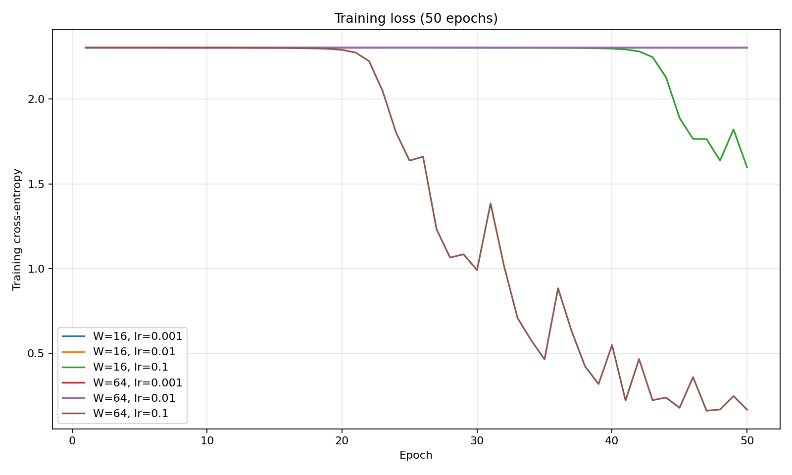

# Lab 2 Report: A Neural Network from Scratch

**Student ID:** 73875  
**Topic:** Handwritten digit classification using a two-hidden-layer neural network

## 1. Objective

Implement and evaluate a fully connected neural network from scratch using NumPy. The tasks include forward propagation, cross-entropy loss, backpropagation, numerical gradient checking, training with multiple hyperparameters, and timing forward and backward passes.

## 2. Dataset and preprocessing

The dataset is `sklearn.datasets.load_digits`, containing 8 × 8 grayscale images of handwritten digits (10 classes). Each image is flattened into 64 input features. Pixel intensities are normalized by dividing by 16. Labels are one-hot encoded into 10-dimensional vectors. Data is split into 70% training and 30% test sets with stratification and `random_state=42`.

## 3. Network architecture

The same architecture is tested with hidden width **W = 16** and **W = 64**:

`Input (64) -> Dense (W) -> ReLU -> Dense (W) -> ReLU -> Dense (10) -> Softmax`

| Parameter | Shape |
| --- | --- |
| W1, b1 | (64, W), (W,) |
| W2, b2 | (W, W), (W,) |
| W3, b3 | (W, 10), (10,) |

Weights are initialized with a normal distribution with mean 0 and standard deviation 0.01; biases are initialized to zero.

## 4. Forward propagation and loss

For a batch of inputs **X**, the computations are:

```text
Z1 = X @ W1 + b1       A1 = ReLU(Z1)
Z2 = A1 @ W2 + b2      A2 = ReLU(Z2)
Z3 = A2 @ W3 + b3      P  = softmax(Z3)
```

The output has shape `(batch_size, 10)`, and each row of softmax probabilities sums to 1. Cross-entropy loss is:

`L = -sum(Y * log(P)) / batch_size`

The observed untrained loss was **2.302595**, close to the expected `ln(10) = 2.302585` for approximately uniform class probabilities.

## 5. Backpropagation and gradient verification

Using the chain rule for softmax with cross-entropy:

```text
dZ3 = (P - Y) / m
dW3 = A2.T @ dZ3             db3 = sum(dZ3, axis=0)
dZ2 = (dZ3 @ W3.T) * (Z2 > 0)
dW2 = A1.T @ dZ2             db2 = sum(dZ2, axis=0)
dZ1 = (dZ2 @ W2.T) * (Z1 > 0)
dW1 = X.T @ dZ1              db1 = sum(dZ1, axis=0)
```

Here `m` is the batch size. The numerical derivative is computed by central difference with `epsilon = 1e-5`:

`g_num = (L(theta + epsilon) - L(theta - epsilon)) / (2 * epsilon)`

Relative error is computed as `abs(g_num - g_analytic) / max(1e-8, abs(g_num) + abs(g_analytic))`.

**Result:** 10 of 10 sampled parameter entries passed the gradient check (required: at least 9 of 10 with relative error below `1e-6`). See `results/gradient_check.csv`. For this check, the implementation temporarily scales weights to avoid numerically uninformative near-zero gradients; the actual training uses the required initialization.

## 6. Training setup and results

Training uses mini-batch stochastic gradient descent, shuffled training examples, batch size **32**, and **50 epochs**. The following results were recorded in the bundled `results/metrics.csv`:

| Hidden width | Learning rate | Final training loss | Test accuracy |
| ---: | ---: | ---: | ---: |
| 16 | 0.001 | 2.302550 | 10.19% |
| 16 | 0.01 | 2.302476 | 10.19% |
| 16 | 0.1 | 1.597017 | 32.59% |
| 64 | 0.001 | 2.302526 | 10.19% |
| 64 | 0.01 | 2.302343 | 10.19% |
| 64 | 0.1 | **0.168405** | **93.89%** |

The best configuration was **W = 64, learning rate = 0.1**, reaching **93.89% test accuracy**. The smaller learning rates barely reduced the loss over 50 epochs. This is consistent with slow learning from the specified small weight initialization; the experiment illustrates how hidden-layer width and learning rate affect convergence.

### Loss curves



The curves are also saved in `results/loss_curves.png`.

## 7. Forward/backward timing

Forward and backward passes were timed separately using the median of 100 runs for a batch of 32 samples. The following measurements are from the bundled `results/metrics.csv` (milliseconds):

| Hidden width | Learning rate | Forward median (ms) | Backward median (ms) |
| ---: | ---: | ---: | ---: |
| 16 | 0.001 | 0.0203 | 0.0221 |
| 16 | 0.01 | 0.0200 | 0.0219 |
| 16 | 0.1 | 0.0199 | 0.0220 |
| 64 | 0.001 | 0.0299 | 0.0374 |
| 64 | 0.01 | 0.0302 | 0.0386 |
| 64 | 0.1 | 0.0307 | 0.0387 |

Backward propagation was slower in these measurements. It computes matrix multiplications both to propagate error signals and to obtain weight gradients, while the forward pass primarily computes one matrix multiplication per dense layer. Increasing hidden width also increases matrix multiplication cost. Timing varies with the computer and numerical libraries; rerunning the script may yield different timings.

## 8. Conclusion

The implementation successfully computed forward and backward propagation, passed the numerical gradient test, and trained all six requested configurations. The strongest result was **93.89% test accuracy** for width 64 and learning rate 0.1. The experiment demonstrated the importance of learning rate and network capacity, and the higher computational cost of backward propagation.

## Files submitted

- `lab02.py` — implementation and experiments
- `requirements.txt` — Python dependencies
- `results/gradient_check.csv` — gradient verification
- `results/metrics.csv` — final accuracy, loss, and timing
- `results/loss_curves.png` — training loss plot
- `report.md` — this report

**Note:** The lab manual additionally asks for the network design and chain-rule gradient derivation *on paper*. The equations above can be used as a guide for preparing that handwritten component.
