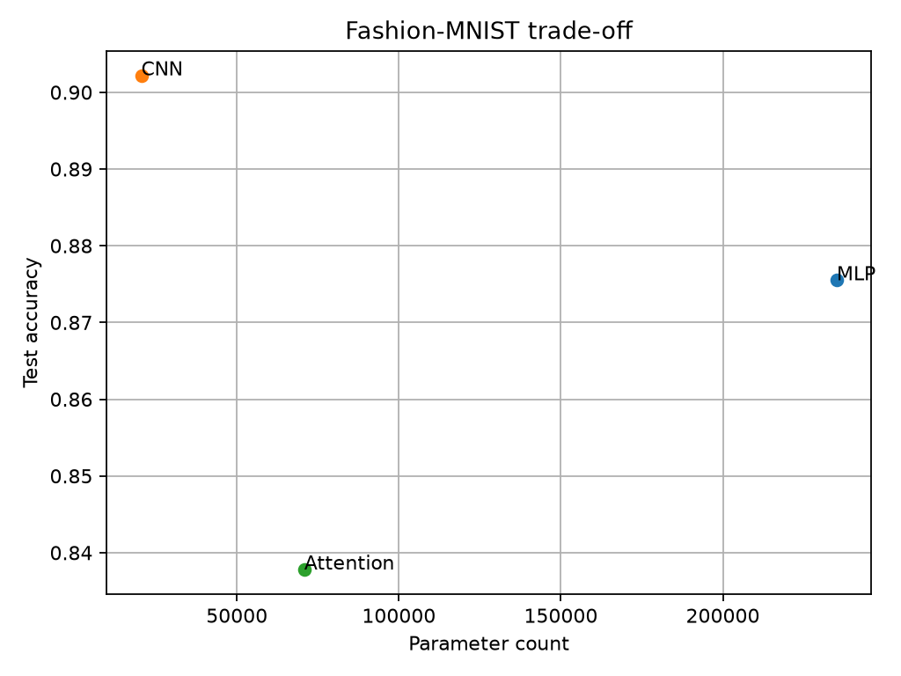
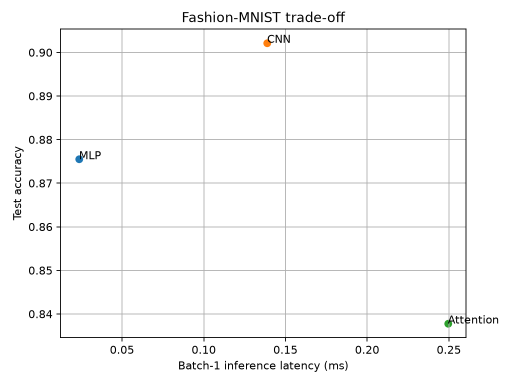

# Lab 3 — Architectures and their costs

## Experimental setup

Device: `cpu`. Fashion-MNIST: 55,000 training / 5,000 validation / 10,000 official test images. Normalize(mean=0.2860, std=0.3530).
All models: Adam (lr=0.001), 5 epochs, batch size 128, random seed 42. Test accuracy is measured on the official test split.
Inference timings: evaluation mode, no gradients, 10 warm-up passes; median of 100 runs for batch 1 and 20 runs for batch 128. CPU timings depend on machine load.

## Measured results

| Model | Parameters | Hand FLOPs* | THOP FLOPs* | Test accuracy | Batch 1 median (ms) | Batch 128 median (ms) |
|---|---:|---:|---:|---:|---:|---:|
| MLP | 235,146 | 469,504 | 469,504 | 87.55% | 0.024 | 0.125 |
| CNN | 20,490 | 2,063,488 | 2,063,488 | 90.22% | 0.139 | 4.152 |
| Attention | 70,794 | 2,329,856 | 1,182,976 | 83.78% | 0.249 | 6.999 |

*FLOPs estimates use 2 operations per multiply-accumulate (MAC). THOP returns MAC estimates; the code multiplies them by 2. Neither count represents all actual CPU instructions.

## Representative hand calculations

**MLP** (linear layers only):

- Linear 784 → 256: 2 × 784 × 256 = 401,408 FLOPs.
- Linear 256 → 128: 2 × 256 × 128 = 65,536 FLOPs.
- Linear 128 → 10: 2 × 128 × 10 = 2,560 FLOPs.
- Total: **469,504 FLOPs** (bias additions and activations excluded).

**CNN** (convolutions and final linear layer):

- Conv 1→16, 3×3, 28×28: 2 × 3 × 3 × 1 × 16 × 28 × 28 = 225,792 FLOPs.
- Conv 16→32, 3×3, 14×14: 2 × 3 × 3 × 16 × 32 × 14 × 14 = 1,806,336 FLOPs.
- Linear 1568→10: 2 × 1568 × 10 = 31,360 FLOPs.
- Total: **2,063,488 FLOPs** (pooling, bias additions, and activations excluded).

**Attention** (16 patches, d=64, feedforward=128, two encoder layers):

- Patch projection: 2 × 49 × 64 × 16 = 100,352 FLOPs.
- Per encoder layer, Q/K/V: 2 × 16 × 64 × (3 × 64) = 393,216 FLOPs.
- Attention QKᵀ scores: 2 × 16² × 64 = 32,768 FLOPs.
- Attention-weighted values: 2 × 16² × 64 = 32,768 FLOPs.
- Attention output projection: 2 × 16 × 64 × 64 = 131,072 FLOPs.
- Feedforward layers: 2 × 16 × 64 × 128 + 2 × 16 × 128 × 64 = 524,288 FLOPs.
- Per encoder layer total: 1,114,112 FLOPs; two layers: 2,228,224 FLOPs.
- Classifier 64→10: 2 × 64 × 10 = 1,280 FLOPs.
- Total: **2,329,856 FLOPs**, excluding softmax, normalization, GELU, biases, pooling and residual operations.

## Why hand estimates and THOP differ

For MLP and CNN, THOP agrees with the hand count for the chosen counted operations. For the Transformer, THOP may not account for all internal multi-head attention matrix products and other functional operations, so its value is an **undercount** relative to this hand estimate. THOP's reported number is not a complete measurement of attention compute. The hand estimate also omits some non-matrix operations. Thus both are approximate and not directly equivalent to execution time.

## Architectural trade-offs

**MLP:** dense layers process flattened pixels, losing explicit 2D locality. The largest parameter count means more weight data to read (about 0.94 MB in float32), but its simple dense kernels achieved the lowest CPU latency in this experiment.

**CNN:** local kernels reuse the same weights across image positions and exploit spatial locality. Pooling reduces later feature-map dimensions. It achieved the highest test accuracy with the fewest parameters, despite more arithmetic and slower CPU inference than MLP.

**Attention:** patches permit global token-to-token interactions, but attention-score computation and memory grow quadratically with token count. Additional projections, normalization and token mixing increase memory traffic and runtime. Here it was slower and less accurate after only five epochs; this does not imply Transformers always underperform.

**Conclusion:** CNN was most parameter-efficient and most accurate for this small image task; MLP was fastest on the tested CPU. Choice depends on whether accuracy, model size or latency is the main constraint.

## Notes and limitations

The lab handout requests architectures 'target 100k–150k parameters', but the exact prescribed layer configurations yield 235,146 (MLP), 20,490 (CNN), and 70,794 (Attention). We preserved the specified architectures rather than modifying them to hit the target.
The patch embedding is implemented as a 7×7 convolution with stride 7, equivalent to a learned linear projection of non-overlapping 7×7 patches.
Results are specific to the random seed, training duration, CPU and software versions; timings are not hardware-independent.

## Plots

## Submission

Include `main.py`, `requirements.txt`, `report.md`, `outputs/results.json`, both plots and a Git commit. Model weight files are optional unless the instructor requests them.
